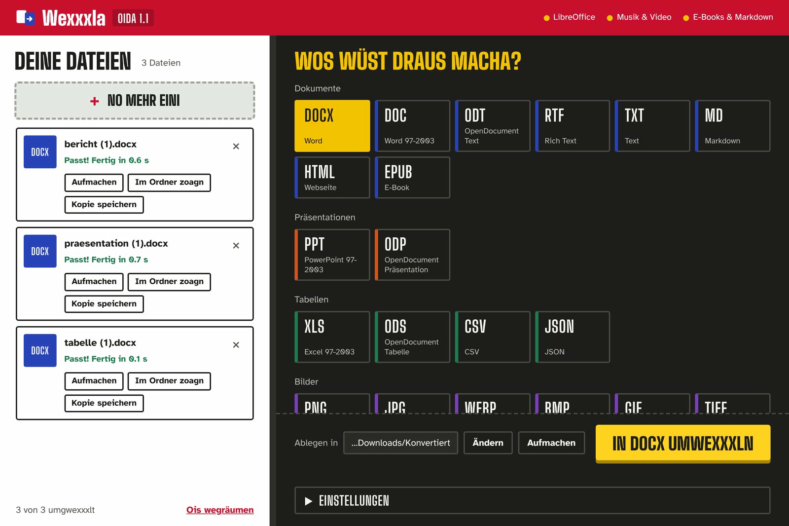
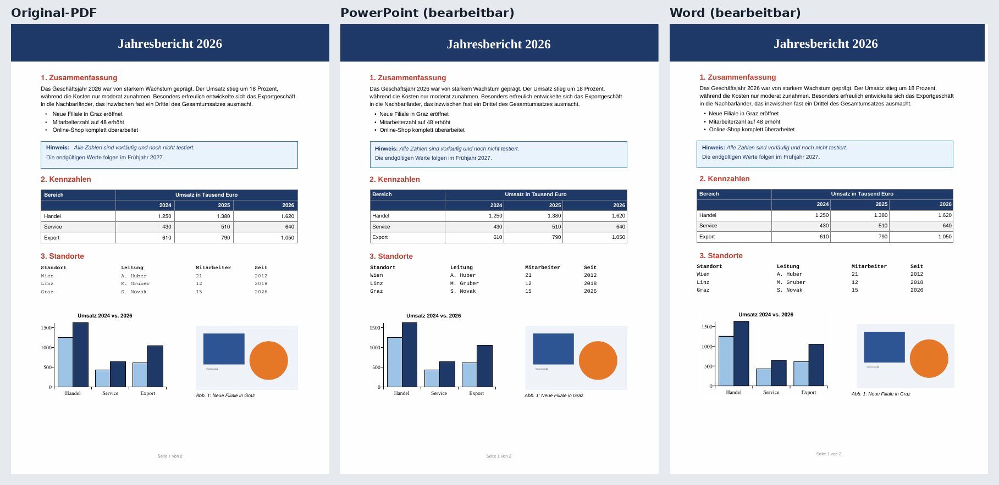

# Wexxxla

**Der Converter, der jede Datei umadum wechselt.** Dateien reinziehen, Zielformat anklicken, fertig – PDF zu Word, PDF zu PowerPoint, Excel zu PowerPoint, Word zu PDF, Video zu MP3 und noch viel mehr. Alles läuft lokal auf deinem PC, nichts wird irgendwo hochgeladen.



## Herunterladen

Unter **[Releases](../../releases/latest)** die Datei `Wexxxla-Oida-…-windows.zip` laden, entpacken und `Wexxxla.exe` starten.
Fragt Windows SmartScreen nach: **Weitere Informationen** → **Trotzdem ausführen**.

## Was Wexxxla kann

| Art | Formate |
|---|---|
| Dokumente | PDF, Word (DOCX, DOC), ODT, RTF, TXT, Markdown, HTML, EPUB |
| Präsentationen | PowerPoint (PPTX, PPT), ODP |
| Tabellen | Excel (XLSX, XLS), ODS, CSV, JSON |
| Bilder | PNG, JPG, WebP, BMP, GIF, TIFF, ICO, HEIC (iPhone), SVG |
| Audio | MP3, WAV, FLAC, OGG, M4A, AAC, Opus, WMA |
| Video | MP4, MKV, MOV, AVI, WebM, WMV, FLV, Video → GIF, Video → MP3 |

- **Drag & Drop**, viele Dateien auf einmal, mehrere Dateien zu einer PDF zusammenfügen.
- **Kein direkter Weg?** Wexxxla geht automatisch über Zwischenformate (z. B. PPT → PPTX → Word).
- **PDF → PowerPoint und PDF → Word mit echter Layout-Erkennung:** Texte mit Original-Schriftart, -Größe und -Farbe, echte Tabellen (auch ohne Linien, mit verbundenen Zellen und Zellfarben), Formen, Diagramme, Infoboxen und Bilder an der richtigen Stelle – bearbeitbar statt Seitenbild.
- **PDF → Excel:** Tabellen landen sauber in Zellen, Zahlen als Zahlen.
- Heller und dunkler Modus, Einstellungen für Qualität, Auflösung, CSV-Trennzeichen und mehr.
- Ohne Oberfläche: `Wexxxla.exe --cli "datei.pdf" docx "C:\Zielordner"`



### Office-Programm

Für Word-, Excel- und PowerPoint-Dateien **als Quelle** (z. B. Word → PDF) und für die alten Formate DOC, XLS und PPT braucht Wexxxla **Microsoft Office** oder das kostenlose **[LibreOffice](https://de.libreoffice.org/download/download/)**. Ist Microsoft Office installiert, wird es automatisch benutzt. Alles andere funktioniert ohne.

## Versionen

Wexxxla-Versionen heißen **Oida**: `Oida 1.0`, `Oida 1.1`, `Oida 2.0` … Die Releases tragen das Tag `oida-<Version>`.

Ein neues Release entsteht automatisch: Versionsnummer in [`converter/__init__.py`](converter/__init__.py) erhöhen und auf `main` pushen. GitHub Actions baut dann `Wexxxla.exe` auf Windows, testet sie und veröffentlicht „Wexxxla Oida \<Version\>“.

## Selbst bauen

Unter Windows: `build_exe.bat` doppelklicken. Das Skript installiert bei Bedarf Python, lädt alle Bibliotheken und baut `dist\Wexxxla\Wexxxla.exe`.

Von Hand:

```bat
python -m venv .venv
.venv\Scripts\pip install -r requirements.txt pyinstaller
.venv\Scripts\python build.py
```

Ohne EXE direkt starten: `python app.py` (oder `start_ohne_exe.bat`).

## Aufbau

| Datei/Ordner | Inhalt |
|---|---|
| `app.py` | Start, lokaler Server und App-Fenster (Edge/Chrome im App-Modus) |
| `web/index.html` | Oberfläche |
| `converter/engine.py` | Formatgraph und automatische Wegsuche über Zwischenformate |
| `converter/pdflayout.py` | Layout-Analyse von PDFs (Text, Schriften, Tabellen, Grafiken, Bilder) |
| `converter/pdf_to_office.py` | baut daraus PowerPoint- und Word-Dateien |
| `converter/office.py` | Microsoft Office bzw. LibreOffice ansteuern |
| `converter/media.py` | Bilder (Pillow), Audio und Video (ffmpeg) |
| `converter/builders.py`, `data.py`, `textfmt.py` | Word/PowerPoint/Excel untereinander, Tabellen, Textformate |

## Lizenz

Wexxxla steht unter der [GNU GPL v3](LICENSE). Die fertige EXE enthält unter anderem ffmpeg (über imageio-ffmpeg) und pandoc, die ebenfalls unter der GPL stehen.
